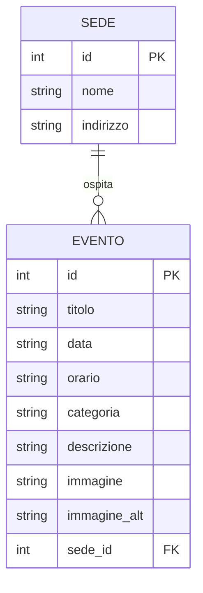

# Scheda dati — Segnale

## Entità

- **Evento**: un appuntamento del festival. Gli eventi sono raccolti in `eventi.json`.
- **Sede**: un luogo in cui si svolgono gli appuntamenti. Le sedi sono raccolte in `sedi.json`.

## Campi di Evento

| Campo | Tipo | Esempio |
|---|---|---|
| `id` | Numero intero | `2` |
| `titolo` | Testo | `Materia seconda` |
| `data` | Testo nel formato AAAA-MM-GG | `2026-06-12` |
| `orario` | Testo nel formato HH:MM | `14:00` |
| `categoria` | Testo | `Laboratorio` |
| `descrizione` | Testo | `Un laboratorio per osservare materiali di recupero e immaginare nuovi utilizzi attraverso piccoli esperimenti.` |
| `immagine` | Testo (percorso del file) | `assets/materia-seconda.svg` |
| `immagine_alt` | Testo alternativo dell’immagine | `Forme sovrapposte che richiamano campioni di materiali` |
| `sede_id` | Numero intero | `2` |

## Campi di Sede

| Campo | Tipo | Esempio |
|---|---|---|
| `id` | Numero intero | `2` |
| `nome` | Testo | `Spazio Forma — Politecnico al Valentino` |
| `indirizzo` | Testo | `Via Mattioli 39, Torino` |

## Chiavi e relazione

Il campo `id` è la chiave primaria di ogni entità. È un numero intero, univoco all’interno della propria entità e stabile nel tempo.

Il campo `sede_id` è la chiave esterna di Evento e fa riferimento a `Sede.id`. Ogni evento si svolge in una sede e ogni sede può ospitare zero, uno o più eventi.

Per esempio, l’evento «Materia seconda» ha `sede_id` uguale a `2` e si svolge nella sede «Spazio Forma — Politecnico al Valentino», che ha `id` uguale a `2`.

## Quantità

I file contengono **6 eventi e 3 sedi**.

## Aggiornamento

Chi gestisce il sito modifica i file JSON nella repository e pubblica le modifiche su GitHub Pages. Per aggiornare il nome o l’indirizzo di una sede, modifica il record corrispondente in `sedi.json`.

## Che cosa mostra la pagina

La pagina Programma mostra una scheda per ogni evento, con immagine, titolo, data, orario, categoria, descrizione e nome della sede. Il nome della sede viene letto da `sedi.json` tramite `sede_id`.

## Schema Evento–Sede

